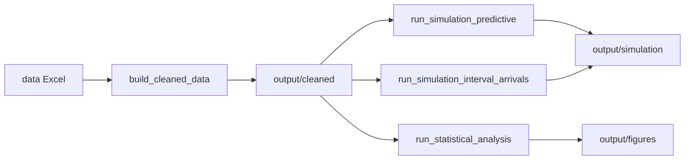

# Group 38 — Analysis of a Waste Recycling Point in Eindhoven Using Discrete-Event Simulation

**Project:** *Analysis of a Waste Recycling Point in Eindhoven Using Discrete-Event Simulation* — a discrete-event simulation of vehicle flow through a multi-station waste recycling point (gate, service stations, capacities), driven by empirical data, plus data cleaning and statistical reporting for **2MBS40** (TU/e).

## Who this is for

- **Course staff and graders** validating reproducibility and pipeline structure.
- **Team members** extending the model, inputs, or analysis.
- **Developers** who need a short path from clone to runnable scripts.

## In scope and out of scope

| In scope | Out of scope |
|----------|----------------|
| Building cleaned CSVs from raw Excel under `data/` | Production deployment, authentication, or APIs |
| Running predictive and interval-based arrival experiments | Real-time or GPS-driven simulation |
| Exporting simulation KPIs and analysis figures to `output/` | Commercial support or SLA guarantees |

## Hardware and OS assumptions

- **OS**: macOS, Linux, or Windows (with PowerShell/WSL for shell commands). CI runs on Linux (GitHub Actions).
- **Hardware**: No GPU or special hardware. Single-threaded, standard laptop/desktop sufficient for the provided experiments.
- **Docker** (optional): If using the provided Dockerfile, any host OS supported by Docker (Linux, macOS, Windows with WSL2) is assumed.

## Quick start (under five minutes)

**Requirements:** Python **3.11** (matches CI), `pip`, and a shell.

```bash
cd Group_38
python3.11 -m venv .venv
source .venv/bin/activate   # Windows: .venv\Scripts\activate
pip install -r requirements.txt
```

**Imports:** Scripts use `from sim....` and `from customtypes ...`. Use **`PYTHONPATH=src`**, typically by running from `src/` with `PYTHONPATH=.` or from the repo root:

```bash
cd src
export PYTHONPATH=.   # Windows PowerShell: $env:PYTHONPATH="."
python run_simulation_predictive.py
```

```bash
PYTHONPATH=src python src/run_simulation_predictive.py
```

## Data

- Raw spreadsheets belong in **`data/`** at the repository root (see `.gitignore`).
- **`build_cleaned_data.py`** produces **`output/cleaned/`** (e.g. `customer_master.csv`) used by simulation and analysis.
- Simulations expect cleaned CSVs under **`output/cleaned/`**.

## Architecture (pipeline)



- **`src/sim/`:** discrete-event core (`engine.py`), arrivals, inputs, experiment loop, reporting.
- **`src/*.py`:** cleaning, simulation drivers, statistics.
- **`src/sim/constants.py`:** hours, capacities, `N_REPLICATIONS`.

## Scripts

From the repository root, with `PYTHONPATH=src`:

| Command | Purpose |
|---------|---------|
| `python src/build_cleaned_data.py` | Excel → `output/cleaned/` |
| `python src/run_simulation_predictive.py` | Empirical day-based arrivals |
| `python src/run_simulation_interval_arrivals.py` | Interval/Poisson arrivals |
| `python src/run_statistical_analysis.py` | Tables and figures |

## Performance

Cost grows with **`N_REPLICATIONS`** (`src/sim/constants.py`), arrival volume (event count), and Excel/pandas work in cleaning and analysis.

## Docker

Image: **Python 3.11** and complete **`requirements.txt`** (runtime, tests, linters, pre-commit stack).

```bash
docker compose build
docker compose run --rm app pytest -q
docker compose run --rm app ruff check src tests
docker compose run --rm app black --check src tests
docker compose run --rm app mypy --config-file=pyproject.toml
docker compose run --rm app pre-commit run --all-files
docker compose run --rm app python src/build_cleaned_data.py
docker compose run --rm app python src/run_simulation_predictive.py
```

```bash
docker build -t group38-sim .
docker run --rm group38-sim
```

## Tests and lint

```bash
pytest -q
ruff check src tests
black --check src tests
mypy --config-file=pyproject.toml
```

**Pre-commit:** after `pip install -r requirements.txt`, run `pre-commit install`. Details: [CONTRIBUTING.md](CONTRIBUTING.md).

## Collaboration and security

- [CONTRIBUTING.md](CONTRIBUTING.md)
- [SECURITY.md](SECURITY.md)

## Citation

If you use this code or build on this work, please cite:

BibTeX:

```bibtex
@inproceedings{ogul2026simulation,
  author    = {Ogul, Mert and Oven, Emir and Nguyen, Vinh and Nechaeva, Anna},
  title     = {Analysis of a Waste Recycling Point in Eindhoven Using Discrete-Event Simulation},
  booktitle = {TU/e 2MBS40 Stochastic Simulation and Modeling Course Assignment 2},
  year      = {2026}}
```

## License

Licensed under the MIT License. See [LICENSE](LICENSE).
